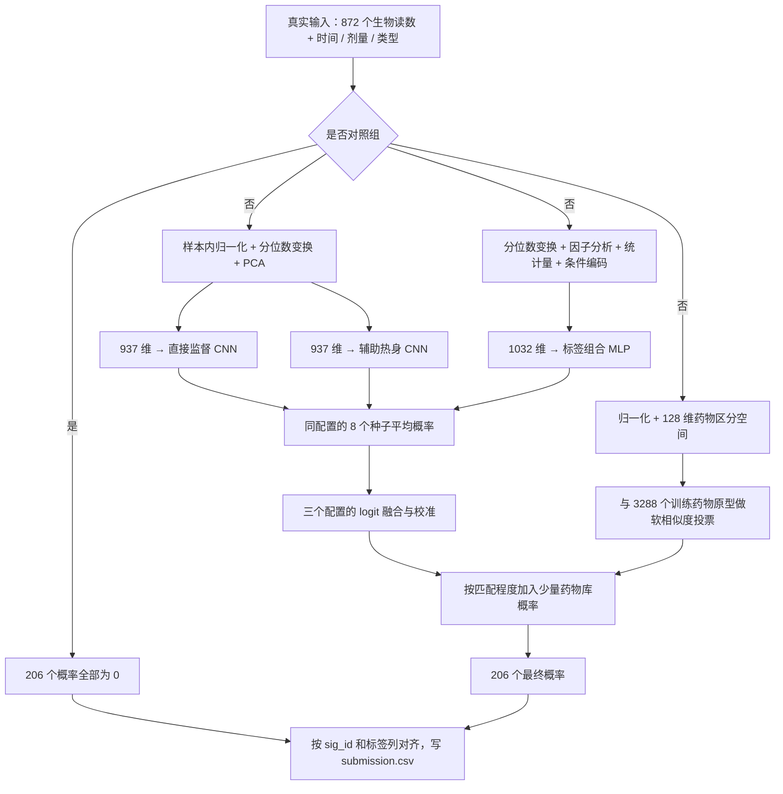

# 从一次细胞实验，到 206 个作用机制概率

先记住一句话：**我们用两种神经网络表示学习药物引起的细胞反应，再用相似训练药物提供少量佐证，通过训练集上的验证来确定怎样组合这些概率。**

项目名是 **MoA Response Library**。MoA 是 Mechanism of Action，即药物的作用机制。整个系统有三种网络训练配置，加一个药物反应原型库。部署时每种网络配置平均 8 个随机种子，共 24 个网络。所有网络最初都随机初始化。

本文里的数值来自保存的实验记录和代码。“为什么这样设计”是建模理由，“实验是否变好”由对照结果支持，两者分开理解。

## 1. 我们到底预测什么

实验人员把某种药物加入细胞，在特定时间和剂量下测量细胞。我们拿到一行数据，回答这次反应与哪些药物作用机制相符。

| 一行输入 | 数量 | 怎么使用 |
|---|---:|---|
| `g-0` 到 `g-771` | 772 | 基因表达相关读数 |
| `c-0` 到 `c-99` | 100 | 细胞活性相关读数 |
| `cp_time` | 1 | 24 / 48 / 72 小时，MLP 使用 |
| `cp_dose` | 1 | D1 / D2，MLP 使用 |
| `cp_type` | 1 | 判断药物处理或对照 |
| `sig_id` | 1 | 对齐输入输出，不作为预测特征 |

`train_drug.csv` 还告诉我们哪些**训练样本**来自同一种药物。它用于验证分组和建立药物原型，不被当成一个神经网络输入。测试集没有药物 ID。

输出是一行 **206 个 0 到 1 的概率**，例如 `dopamine_receptor_antagonist` 等机制分别有多大概率为真。一种药物可以有多个机制，因此是**多标签分类**。206 项概率不要求加起来等于 1。

官方训练数据有 23,814 行，其中 21,948 行是药物处理，1,866 行是对照。公开测试输入有 3,982 行，其中 358 行是对照。还有 402 个不参与评分的辅助标签，仅在训练时帮助学习；最终 CSV 只输出 206 个计分标签。

训练标签很稀疏。处理样本的全部标签格子中，大约只有 0.373% 是阳性。少数机制只有极少正例；同一种药物又有多次相关实验。所以需要控制过拟合，也需要认真设计验证。

### 评分为什么要求概率

单个真实标签 `y` 和预测概率 `p` 的二元 log loss 为：

```text
loss = -[y × ln(p) + (1-y) × ln(1-p)]
```

对所有样本和 206 个标签取平均，越小越好。计算时把概率裁剪到 `[1e-15, 1-1e-15]`。

真实为 1，预测 0.9 的损失约为 0.105，预测 0.001 则约为 6.908。因此，把少数真正的机制错压到接近零会付出很大代价。因为绝大多数格子又是 0，随意把全部概率提高也会增加大量损失。我们需要准确、可信的概率，不能只比较 accuracy，也不能把输出统一按 0.5 切成 0 或 1 再提交。

## 2. 先看整张图



CNN 学习重新组织后的读数组合。MLP 同时学习单个标签与标签共现。药物库利用同一种药物的多次实验形成参考响应。它们犯错的方式不完全相同，组合后有机会比单独使用某一个更稳定。

## 3. CNN 怎样读一条实验

### 先让样本内的相对变化更明显

基因和细胞两组读数分别处理。对一组数，计算第 25 和第 75 百分位数，取两者中点，再从这一组的每个数减掉它。

例如某样本基因读数整体偏高，我们更关心哪些位置相对高、哪些位置相对低。减掉样本自己的中心，可以减轻整体偏移的影响。细胞组还除以 `4 + 第75百分位的绝对偏差`，减少尺度差异的影响。这里用的是每条样本自己的值，不需要看其他测试样本，也不使用标签。

随后进行训练部分拟合的逐列分位数变换，将各维度变成更便于优化的近似正态分布。再分别计算 50 个基因主成分和 15 个细胞主成分，并按各主成分标准差缩放。

**PCA 特征是追加的。** 原来的 872 维保留，因此 CNN 输入是 `872 + 50 + 15 = 937` 维。验证或测试样本只使用保存的变换参数，不重新拟合。

### 卷积前为什么先做全连接投影

基因列的相邻编号不代表图像中的相邻像素。我们先用全连接层把 937 维变成 4,096 维，再排成 256 个通道、每通道 16 个位置，让模型自己组织适合后续卷积的表示。

不能把这 16 个学习位置解释成 16 个真实时间点或基因组位置。

| ResponseCNN 的阶段 | 一个批次的形状，B 是样本数 |
|---|---|
| 输入 | `B × 937` |
| BatchNorm → Dropout 0.1 → Linear → CELU | `B × 4096` |
| 重排 | `B × 256 × 16` |
| Conv1d，256→384 通道，核宽 5 → BN → SiLU → 平均池化 | `B × 384 × 8` |
| Conv1d，384→384，核宽 3 → BN → SiLU | `B × 384 × 8` |
| 门控支路，Conv3 → BN → SiLU → Conv1 → Sigmoid | `B × 384 × 8` |
| 主特征乘以 `2 × gate` | `B × 384 × 8` |
| 最大池化 → 展平 | `B × 1536` |
| BatchNorm → Dropout 0.2 → Linear | `B × 206` logits |
| Sigmoid | `B × 206` 概率 |

门输出在 0 到 1 之间，因此乘数在 0 到 2 之间。它可以压低某些模式、保留或放大另一些模式。门是从训练数据学出来的。一个 CNN 有 **5,690,912 个可训练参数**。

### 两个 CNN 的区别在训练配置

`response_cnn5` 直接用 206 个计分标签训练。

`response_aux5` 的网络结构相同，训练前先做一步：只用当前训练部分，找出与计分标签关联较强的 33 个辅助标签，换上临时输出层训练一轮。之后放回原来随机初始化的 206 维输出层，保留已经热身的特征提取器，再训练正式任务。

它同时使用一个温和的阳性权重，依据训练部分的标签频率略微降低常见阳性的损失权重。它并没有把稀有阳性无限放大。这套“热身 + 加权”配置整体取得了更低的 OOF 损失；现有实验同时改变了两项，不能断言收益分别来自哪一项。

两种 CNN 都使用 Adam、25 轮 OneCycle 学习率安排、批量 128、标签平滑 0.001、CUDA BF16 训练。标签平滑把负例目标改成 0.0005，正例改成 0.9995，以减少过度自信；验证仍用原始 0/1 标签计算标准 log loss。

## 4. MLP 为什么增加“标签组合头”

### 输入与普通宽 MLP

这部分沿用小组原有宽 MLP 的特征思路，输入构成为：

| 来源 | 维数 |
|---|---:|
| 872 个读数经逐列分位数变换 | 872 |
| 基因 / 细胞的因子分析结果 | 90 + 50 |
| 基因、细胞、合并三组各 5 个统计量 | 15 |
| 时间 one-hot 3 维、剂量 one-hot 2 维 | 5 |
| 合计 | **1,032** |

五个统计量是和、均值、标准差、峰度、偏度。拼接后全部列再做一次训练部分拟合的分位数变换，条件编码也包含在内。因子分析可以理解为从大量相关测量中提取少量共同变化因素。

MLP 是 `1032 → 2048 → 2048 → 输出层`，隐藏层使用 LeakyReLU，配合 BatchNorm、Dropout 0.25，第一层和输出层使用 weight normalization。

### 一次预测做两个任务

直接头输出 206 个 logit，经 Sigmoid 得到每个机制的独立概率。

组合头则把训练部分出现过的一整套标签组合视为一个类别。组合的定义使用 **206 个计分标签 + 402 个辅助标签**，因此能区分计分标签相同、辅助注释不同的训练模式。全量处理数据有 328 种计分组合、696 种联合组合；五折时每个训练折单独建词表，类别数 K 不一定是 696。

所以全量 MLP 的原始输出数为 `206 + 696 = 902`。它的可训练参数为 **8,173,340**。组合类别通过 Softmax 得到总和为 1 的概率，再转换回 206 个机制概率。

看一个只含 A、B 两种机制的小例子：

| 训练组合 | 组合头给出的概率 |
|---|---:|
| 什么机制都没有 | 0.10 |
| 只有 A | 0.20 |
| 只有 B | 0.30 |
| 同时有 A 和 B | 0.40 |

“包含 A”的组合概率相加，得到 `P(A)=0.20+0.40=0.60`。同理 `P(B)=0.30+0.40=0.70`。两项和为 1.30 完全正常，因为 A 和 B 可以同时发生。

最后，将组合头推导出的 206 个概率与直接头的 206 个概率**各占一半平均**。直接头提供灵活的逐标签预测，组合头引入训练中观察到的标签共现。遇到未见过的组合时，直接头仍能输出概率；这不保证新组合一定预测正确。

训练损失是 `直接头的平均 BCE + 组合类别交叉熵 / 206`。除以 206 是为了让一个组合分类任务与 206 个二元任务的平均损失处在合适的比例。代码并没有对两头平均后的概率再计算一个 BCE。

## 5. 药物库到底存了什么

我们核查了 3,288 种训练药物，同一种训练药物的多次处理实验都共享同一组计分标签。于是可以把同药物的多次实验作为“同一对象的多次带噪观察”，建立一个平均响应原型。

步骤如下：

1. 对 872 维读数做样本内归一化、`asinh` 变换和训练部分的列标准化。
2. 按训练药物分组求平均。样本减去自己药物均值后的残差，用来估计同药物重复实验的波动。
3. 根据“药物之间的差异”与“同药物内部的波动”，求一个带正则化的广义特征值问题，取 128 个方向。
4. 将每种药物的均值投影到这个空间、归一化为单位向量，连同它的 206 个标签和样本数存下来。
5. 对新样本做同一变换，计算与每个训练药物原型的余弦相似度，用 `Softmax(24 × 相似度 + ln(药物样本数))` 得到投票比例，再加权平均原型标签。

直观上，它尝试找到“同药多次测量相对稳定、不同药物又容易区分”的方向。样本数也进入权重，所以结果并非只由最近的一个药物决定。

这里没有通过测试 ID 查询标签。测试样本只凭自身读数与训练原型比较；即使换掉测试 `sig_id`，预测也应相同。每个验证折的库仅使用该折训练侧药物和标签。部署库使用完整训练处理数据。

这种方法仍可能受到新药物分布、相似但机制不同的响应影响，因此只给它受限制的融合权重。它不是“找到真实药物身份”的保证，也没有证明恢复了生物因果机制。

## 6. 三种网络和药物库如何合成一份答案

先对同一配置的 8 个种子做**概率平均**，得到直接 CNN、组合 MLP、辅助 CNN 的概率 `p1,p2,p3`。随机种子改变初始化和训练过程，平均可以减少单次训练的不稳定性。

随后使用 `logit(p)=ln[p/(1-p)]`。可以把 logit 理解为概率对应的“支持程度”；0.5 对应 0，低概率对应负值，高概率对应正值。

最终保存的神经网络组合为：

```text
z = 0.279946 × logit(p1)
  + 0.379818 × logit(p2)
  + 0.450498 × logit(p3)
  + 0.465227
pNN = sigmoid(z)
```

这三个系数的和约为 1.110262，因此其中同时包含混合比例与整体概率校准。发布清单把它等价地拆成“和为 1 的成员权重 + 一个整体斜率 + 一个截距”。系数从训练 OOF 预测拟合，不是根据 Public 或 Private 分数搜索出来。

最后令 `c` 为药物库最大余弦相似度，裁剪在 0 到 1：

```text
g = 0.250143 × c
p最终 = (1-g) × pNN + g × p药物库
```

例如最大相似度为 0.8，药物库占比约为 20%。若某标签神经网络给 0.10、库给 0.40，最终约为 `0.8×0.10 + 0.2×0.40 = 0.16`。这是机制说明的示例，不是某个真实样本的测量结果。

先平均种子概率，再转 logit；不能随意交换顺序。Sigmoid 和 Softmax 也不能互换，前者用于可同时存在的机制，后者用于“当前属于哪种组合或给哪个原型多少投票比例”。

## 7. 验证与最终训练为什么是两套权重

验证需要一部分有标签的数据留出来，假装它们是未知样本。部署则希望充分使用所有训练标签。两者目的不同。

### 五折验证

`data/folds.csv` 固定了与此前实验相同的划分。5 折各约 4,389–4,390 个处理样本，固定划分种子为 42，网络训练种子为 0–4。每次拿 4 折训练、1 折验证，共得到每条样本的 OOF，也就是“训练时留出该行”的预测。

出现不超过 18 次的药物，其全部处理样本都在同一折；9 种高频药物允许跨折。因此主要约束了小样本药物隔离，**不是全部药物都在训练和验证间完全隔离的协议**。高频药物在训练侧可能有同药其他实验，不能将当前结果宣传为完整的新药冷启动能力。

分位数变换、PCA、因子分析、辅助标签选择、组合词表、药物库都只在当次训练部分拟合。对照组标签在官方训练中全部为 0，训练时剔除，推理按已知 `cp_type` 直接置零。

融合参数采用交叉拟合：评估第 f 折时，只用其他 4 折的 OOF 和标签拟合融合参数，再应用到第 f 折。部署参数最后用全部 OOF 拟合。我们还做了折内按药物分半、互换拟合和评估的敏感性检查。

基网络仍用验证折选择最佳轮次，因此 OOF 含有模型选择影响；跨折基础模型的训练数据也会互相重叠。这里不是完整嵌套 CV，最终泛化证据仍需结合 Kaggle 评分理解。

### 全量重训

固定验证折 0 做过训练规模对照。三种网络各用相同的三个种子：每次约 13,168 行训练时融合损失 0.01713202，每次 17,558 行时为 0.01696857。这支持使用更多训练样本，但仅是一个留出折上的证据。

正式部署使用全部 **21,948 行处理样本**，每种配置 8 个种子。训练停止轮次取此前五折最佳轮次的中位数，直接 CNN / MLP / 辅助 CNN 分别为 **18 / 7 / 22**。

学习率仍按原来 **25 轮的 OneCycle** 安排，只是在上述轮次停止。把 OneCycle 总长度改成 18、7、22，会改变训练轨迹。单折规模检验因计算中位数时排除了验证折，MLP 用的是 8 轮，不能误写成正式 MLP 也训练 8 轮。

因此有 75 个 CV 网络用于实验，有 24 个全量网络用于部署。发布清单里的 `folds=1` 表示每个种子只保存一份全量模型，不代表作业只做了一折验证。

## 8. 哪些效果已经有证据

以下都是统一冻结五折、只计算处理行的 log loss。对照组置零后的全行分数不能与处理行分数直接混为一列。

| 比较项 | 处理样本 OOF |
|---|---:|
| 本次可重跑的最小基线：训练折各标签平均频率 | 0.02287174 |
| 旧 Course5，包含其原校准 | 0.01706366 |
| 直接 CNN，5 种子 | 0.01701975 |
| 组合 MLP，5 种子 | 0.01708700 |
| 辅助热身与加权 CNN，5 种子 | 0.01698392 |
| 三配置神经网络交叉拟合融合 | 0.01678997 |
| 加入药物库，交叉拟合融合 | **0.01672507** |

MLP 单独的分数不是最优，但与其他分支组合有价值的可能性不能只由单模型名次判断。现有表证明整个神经网络融合比这些单分支更好；没有逐个移除 MLP 的消融，所以不能精确声称 MLP 单独贡献了多少。

最终方法对照 Course5，五个折都改善。全行 OOF 为 0.01541454；小样本药物行从 0.01869685 降到 0.01840950。按药物整组做配对 bootstrap，损失差的 95% 区间为约 `[-0.000414, -0.000266]`。这说明在当前开发验证协议上改进较稳定，不能保证任何新测试分布都改善。

正式 late submission **57940904** 的 Public 为 **0.01814**，Private 为 **0.01590**。相对旧 Course5 的 0.01866 / 0.01629，两项分别降低 0.00052 / 0.00039。相对本组给出的第五名门槛，Private 好 0.00012，Public 还差 0.00009。Public 与 Private 来自测试集的不同评分部分，两者绝对数值不能直接横向比较。

仍有失败。206 个机制中 150 个的 OOF 改善，但 `hcv_inhibitor` 的损失变差。样本 `id_344ef5019` 的真实标签 `nitric_oxide_production_inhibitor`，旧版给约 0.00033，最终验证预测约 0.00048，仍严重低估。报告可以用它说明稀有阳性难点。

课程明确要求有在线评分时对照榜单，不能用较低的本地 CV 数字替代官方排名，也不能保证分数或课程成绩。正式报告与展示还要根据模板完成数据分析、基线、验证、改进、结果、AI 使用、反思与复现说明。

## 9. 如何从输入文件一路跑到输出

日常运行只需：

```powershell
conda activate cs4486
python predict.py
```

沿着代码追一次：

1. `predict.py` 读取 `test_features.csv` 和提交模板，确认 206 个标签顺序，读取发布清单。
2. 解开 `.moa` 文件中的预处理器、24 个网络权重和药物库到临时目录。`.moa` 是 ZIP 容器，只是使用不同扩展名。
3. `infer_engine.run_inference` 根据 `cp_type` 筛出处理样本，给每种配置调用 `predict_member`。
4. `build_features` 使用保存的参数分别生成 937 / 1032 维特征，`models.py` 重建网络并加载权重。
5. 逐配置平均各随机种子概率；`drug_library.library_for_test` 产生药物库概率和相似度。
6. `blend_and_write` 做 logit 融合、校准、库融合，将对照行置零，按 ID 对齐后写出 `outputs/submission.csv`。
7. 临时解压文件清理。最终 CSV 有 `sig_id` 和 206 个机制概率列，可用于相应提交流程。

训练过程见 README 的 `reproduce.py` 分阶段命令。推理不读取标签、OOF 或已经保存的公开预测文件。换成新 ID 或另一批合法输入仍重新计算。

### 为什么从 5 GB 变成约 114 MB

旧的大包包含大量模型和重复产物。最终部署只包含 24 个网络，且对大权重矩阵按输出行、卷积按输出通道存 INT8：

```text
scale = max(abs(这一行权重)) / 127
整数权重 = round(权重 / scale)
推理恢复权重 ≈ 整数权重 × scale
```

偏置、BatchNorm 等敏感参数保留原精度，标签组合映射保留 uint8。运行时恢复到 FP32 计算，因此这是压缩存储，不是声称全部推理运算都用 INT8。

已经测过量化误差，第 0 折损失变化约为 `+1.59×10^-7`。发布包全部输入总量为 **113.96 MB**；此前本机完整 CPU 推理约 31 秒，Kaggle 的同版 CPU 环境约 11 分 55 秒，两台环境耗时不能保证一致。

本次整理重新核对原发布包全部文件哈希，并执行顶层代码与冻结 Notebook。详细误差和测试项写在 `evidence/final_verification.json`。分享 ZIP 不带可重建的 FP32 训练产物和原始 CSV；本地项目目录保留它们。Kaggle 只需上传 `response_release/dataset/` 并运行对应 Notebook。

## 10. 哪些代码是新设计，哪些是继承和整理

| 来源 / 工作 | 文件 | 内容 |
|---|---|---|
| 沿用小组原有思路 | `features.py`、`models.py` 的 SimpleNN | 宽 MLP 与分位数、FA、统计特征 |
| 最终方案新增 | `response_features.py` | 样本内归一化和 PCA 表示 |
| 最终方案新增 | `models.py` 的 ResponseCNN、ProfileMLP | 门控卷积与直接 / 组合双头 |
| 最终方案新增 | `drug_library.py` | 重复实验估计波动、药物原型与软投票 |
| 最终方案新增 | `response_study.py`、`refit_response.py` | 对照、交叉拟合、规模检验、全量训练 |
| 最终方案部署 | `response_release.py`、`infer_engine.py`、`kernel.py` | INT8 存储、实际输入推理、Kaggle 入口 |
| 本次整理新增 | `config.py`、`artifact_utils.py`、`recipes.json`、`reproduce.py` | 独立路径、通用工具、训练配置与流水线 |
| 本次整理新增 | `predict.py`、`verify_project.py`、`baseline.py` | 本地入口、完整核对、最小基线 |
| 本次整理新增 | README、本文、归档索引 | 运行、理解、历史位置 |

样本内归一化、先投影再卷积和辅助标签热身参考了 [竞赛亚军的公开代码仓库](https://github.com/baosenguo/Kaggle-MoA-2nd-Place-Solution)。宽 MLP 背景参考 [竞赛冠军公开方法说明](https://www.kaggle.com/competitions/lish-moa/writeups/hungry-for-gold-1st-place-winning-solution-hungry-)；历史分折参考了药物分组思路。本项目使用自己的具体门控结构、辅助标签筛选、组合头、药物库和融合验证，不能把这些补充实现宣称为原作者规定的方案，也不是某篇指定论文的严格复现。

本轮及此前实现、实验和整理包含 AI 参与。上表区分代码来源与改动，并不声称这些新设计全部由学生独立完成。请依据实际工作填写课程的 AI 使用、每位组员的独立设计、实现、反思和实际工时。课程对直接使用 AI 完整方案有明确限制，理解代码与如实披露都需要落实；这里不能代替教师对独立性的判断。

## 11. 试着用自己的话回答

1. **为什么是 206 个 Sigmoid，而不是一个 206 类 Softmax？** 同一个药物可能同时有多种机制。
2. **卷积看到的“位置”是什么？** 全连接层学出的表示位置，不是真实时间轴或相邻基因。
3. **组合头为什么用 Softmax，又怎样回到多标签概率？** 联合组合互斥；把包含某机制的组合概率相加，得到该机制的边缘概率。
4. **辅助标签为什么能用，最终为什么不提交它们？** 它们是官方训练注释，可用于表征学习；评分仅考察 206 个标签，测试输入没有辅助标签。
5. **药物库没有测试药物 ID，怎样工作？** 根据新样本读数与训练原型的相似性软投票。
6. **怎样避免预处理偷看验证数据？** 每次只在该折训练部分拟合，验证只 transform；组合词表和原型库也同样处理。
7. **为什么有五折，又只有 24 个部署网络？** 五折用来验证和确定设置，部署在全部训练数据上按固定轮次重训三种配置各 8 个种子。
8. **为什么 MLP 的 OOF 没有最好还保留？** 需要考虑与 CNN 错误的互补；整体融合有实测收益，单独移除 MLP 的贡献尚未独立测定。
9. **为什么不用 0.5 阈值？** 评分直接计算概率的 log loss，阈值会损失概率信息。
10. **到底达到哪条 Top 5 分数线？** Private 优于本组历史门槛，Public 仍差 0.00009；不能说两榜均达到。

如果能不看答案讲清这十点，再亲自执行一次 `predict.py` 并对照上述函数跟踪一遍，就掌握了项目主线。更细的层参数在 `models.py`，实验数字的依据在 `runs/response_study/` 与 `evidence/`。
